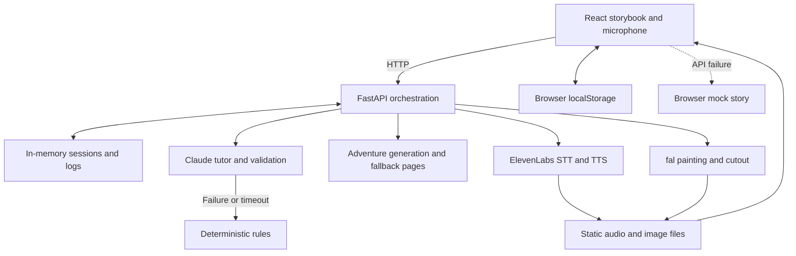

# Speakaboo

**Big stories for little voices.** Speakaboo is an interactive bedtime storybook for children aged 4–6: a child builds an illustrated avatar, listens to a story, and speaks to answer questions or choose a path. Parents can see words practised, hints needed, and the tutor's decisions. It supports speaking and vocabulary practice; it is not speech therapy or a pronunciation assessment.

Built for the Imperial AI Hackathon with a React/Figma Make frontend, a FastAPI backend, Claude, ElevenLabs, and fal.

## Try the experience

Run the app locally using the instructions below. Choose **Try the demo**, select a child, and open **Pip's Gentle Journey Home** or **Your own adventure**. The login form is a UI prototype, not authentication. “Try the demo” selects an example profile; it still attempts to use the backend.

Implemented in the current source:

- **Pip's story:** five scenes per playthrough, including a sun/moon quiz and a bridge/boat branch.
- **Generated adventures:** four pages, with a prewritten opening, generated later pages, learning questions, and choices. Pictures come from an existing background catalogue.
- **Voice interaction:** narrated pages and questions, automatic microphone recording, spoken answers, retries, and tappable choices.
- **Adaptive tutoring:** repetition, recall, counting, colour, two-option, and open questions, with validated model decisions and rule-based fallbacks.
- **Personalized artwork:** a drawn avatar can be repainted in watercolour and cut out on fal while the story starts.
- **Parent progress:** session metrics, stars, notes, decision history, and browser-local history and practice words.

No public frontend demo URL is verified here. The remote backend address in [frontend configuration](frontend/src/config.ts) is a configured default, not a deployment-health guarantee.

## Quick start

### Prerequisites

- Python with `venv` and `pip`. The source uses Python 3.10+ syntax, but the repository does not pin a Python version or establish a tested minimum for all dependencies.
- Node.js **22.12+ within the 22.x series** and **pnpm 10.34.3**: [the toolchain file](frontend/.mise.toml) selects Node 22 and that pnpm version; the [lockfile](frontend/pnpm-lock.yaml) requires at least Node 22.12 on that line.
- A browser with microphone permission; use localhost for development or HTTPS when hosted.

**Verification status:** commands and paths below were checked against repository configuration. A clean dependency install, backend startup, frontend build, tests, and live service calls were not executed for this README update: the review environment lacked Node/pnpm and the backend dependencies. Model access and browser microphone behaviour still need an end-to-end check.

### Backend

From the repository root, create and activate a virtual environment:

```powershell
# Windows PowerShell
py -m venv .venv
.\.venv\Scripts\Activate.ps1
```

```bash
# macOS / Linux
python3 -m venv .venv
source .venv/bin/activate
```

With the environment active:

```sh
python -m pip install -r requirements.txt
```

Copy [.env.example](.env.example) to `.env` if you do not already have one (`Copy-Item .env.example .env` in PowerShell; `cp .env.example .env` in a POSIX shell). Fill only the credentials you intend to use, following the configuration table below. Keep `.env` local.

```sh
python -m uvicorn agent.main:app --reload --host 127.0.0.1 --port 8000
```

Open `http://localhost:8000/docs` to confirm the server started. Keep one backend worker: sessions are held in process memory.

### Frontend

In another terminal:

```sh
cd frontend
pnpm install --frozen-lockfile
```

Create `frontend/.env.local` containing:

```dotenv
VITE_API_URL=http://localhost:8000
```

This file is ignored by the [frontend's gitignore](frontend/.gitignore). Without this setting, the UI calls the configured remote backend instead of your local server. Restart Vite after changing it.

```sh
pnpm dev
```

Open `http://localhost:8443`. [Vite configuration](frontend/vite.config.ts) uses port 8443 by default, without local HTTPS, and requires that port to be free. Set `PORT` to change it. The checked-in `frontend/.figma/` configuration is required by the build.

To check a first session, open Pip's story, answer “lantern,” try an incorrect sun/moon answer to hear a hint, then choose a river crossing. With voice credentials absent, use **Demo controls**, choice cards, or **Turn the page**. Demo controls simulate answers and do not test transcription.

## Configuration and external services

Backend variables are loaded from the root `.env` or process environment. Store deployed secrets in the hosting service's environment settings. Only the backend URL belongs in the frontend; `VITE_*` values are exposed to the browser.

| Variable | Enables | Behaviour when unavailable |
|---|---|---|
| `ANTHROPIC_API_KEY` | Claude tutoring and adventure generation; configured model: `claude-sonnet-5-5` | Tutor uses deterministic rules; adventures use prewritten fallback pages |
| `ELEVENLABS_API_KEY` | STT with `scribe_v1` and TTS with `eleven_flash_v2_5` | Failed transcription becomes silence; missing speech files fall back to browser speech synthesis where supported |
| `VOICE_ID` | Selects the ElevenLabs speaking voice | TTS can fail; use a voice accessible to the account |
| `FAL_KEY` | Avatar repainting with `fal-ai/flux-pro/kontext`, then background removal with `fal-ai/birefnet` | The drawn avatar remains available |
| `PAINT_AVATAR` | Defaults to `1`; `0` disables painting | No new avatar painting requests |
| `ADVENTURE` | Defaults to `1`; `0` maps adventure requests to Pip's story | Optional switch supported by code; not currently listed in `.env.example` |
| `VITE_API_URL` | Frontend's backend address, set in `frontend/.env.local` | Uses the remote default in `config.ts` |

`TAVILY_API_KEY` and `E2B_API_KEY` are legacy/example variables. They are used by the separate `check_keys.py` utility, not the story application.

**Costs:** enabled Claude, ElevenLabs, and fal calls can incur provider charges. Session start warms connections and prepares speech; adventure mode generates both possible next pages before the child chooses, including an unused branch. Avatar results are cached by drawing and appearance traits. A missing key does not require enabling a paid service: the app has fallbacks, although missing ElevenLabs credentials prevent the real voice-input path from working.

### Live backend versus mock demo

[mockApi.ts](frontend/src/mockApi.ts) tries the real API first. If session start fails, it uses a separate browser mock story; failed turns also fall back, with two consecutive turn failures switching the session to mock-only operation. The mock has different content and simplified scoring.

- Open **Demo controls** on a non-final page to see the `offline demo` badge when the UI reports fallback. Confirm live traffic in the browser Network panel: successful `/session/start` and `/turn` requests to the intended backend.
- A successful backend response does **not** prove Claude ran successfully. Check backend logs for `source=agent` versus `source=fallback`, and `fallback_reason`. Progress entries expose `source` as `agent` or `rule`; authored quizzes and branches still use rules for their decisions even when Claude writes the wording.
- Narration may be browser-generated speech, and an avatar may still be the original drawing. Check returned audio/avatar URLs when demonstrating those integrations.

## Architecture



[App.tsx](frontend/src/App.tsx) draws the avatar, exports a PNG, starts a session, and plays narration followed by a challenge. It records until silence or an eight-second limit, then uploads the audio. [main.py](agent/main.py) transcribes it, requests a tutor decision, updates state, and returns feedback plus the next scene. The browser follows `retry`, scene identity, and `story_complete`; an exhausted-attempt miss can still advance the story.

[tutor.py](agent/tutor.py) makes one model call per tutoring turn with structured tools: `assess`, `set_difficulty`, `next_step`, `ask`, and `notify_parent`. Code validates actions, levels, questions, and wording. Authored quizzes and branch navigation are decided by [fallback.py](agent/fallback.py); Claude can phrase the response. Slow or invalid tutor output falls back after six seconds. [questions.py](agent/questions.py) defines question types and easier retries.

[adventure.py](agent/adventure.py) generates later pages against a [background catalogue](data/backgrounds.json), with a ten-second generation limit and prewritten replacements. Pages 1–3 have a question phase followed by a choice phase; page 4 ends with goodnight. [Pip's story](data/story.json) remains independently playable. Existing scene images are served from disk, not generated per turn.

Runtime prompts: [tutor](prompts/story_agent.md) and [adventure](prompts/adventure.md). Service adapters: [voice](tools/voice.py) and [avatar](tools/paint_avatar.py).

### API overview

| Endpoint | Input and result |
|---|---|
| `POST /session/start` | JSON child profile, optional `avatar.image_png`, `practice_words`, `story`, and `resume_scene_id`; returns IDs, introduction, stars, and first scene |
| `POST /turn` | Multipart `session_id` + `audio`, or JSON `session_id` + `transcript`; optional JSON `skip: true` moves on without scoring. Returns assessment, feedback/audio, stars, retry flag, and scene |
| `GET /progress/{child_id}` | Aggregates that child's in-memory sessions; unknown IDs return 404 |
| `GET /static/...` | Serves scene images, generated MP3s, and painted avatars |

Use the returned `child_id` for progress. On completion, `story_complete` is true and `scene` is null. See [request/response examples](contract/) and [endpoint implementation](agent/main.py); example narration is illustrative. `/docs` exposes the routes, but detailed body schemas are limited because handlers parse requests manually.

## Testing

From the root with the Python environment active:

```sh
python -m pytest -q
```

[Test fixtures](tests/conftest.py) replace Claude, ElevenLabs, and fal calls. Tests cover contracts, rules, tutor validation, questions, avatar handling, adventures, and progress; they do not establish live provider availability.

From `frontend/`:

```sh
pnpm exec tsc --noEmit
pnpm build
```

There is no frontend automated test script configured. These are type/build checks; playback and microphone behaviour require browser testing.

Manual integration tools, separate from the normal test suite:

| Command from repository root | Purpose |
|---|---|
| `python tests/try_paint_avatar.py` | Uploads the synthetic sample to fal; writes painted and transparent previews under `tests/avatar_results/`; requires `FAL_KEY` and uses credits |
| `python tests/voice_roundtrip.py path/to/clip.webm` | Sends a supplied clip to ElevenLabs, prints its transcript, and saves spoken output; requires voice credentials and can incur charges |
| `python tests/benchmark_tutor.py --baseline-ref HEAD` | Dry-run prompt comparison; select another Git revision for a meaningful baseline. Adding `--live` makes billable synthetic tutor calls and requires `ANTHROPIC_API_KEY` in the process environment |

`check_keys.py` is an older Anthropic/Tavily/E2B check, not an application health check; it does not verify ElevenLabs or fal.

## Data and limitations

| Data | Storage and lifetime |
|---|---|
| Sessions, backend profiles, progress logs, adventure pages | Python memory; lost on restart and not shared between workers |
| Created/edited frontend profiles | React memory; lost on reload |
| Completed-story history, focus words, saved Pip page, avatar URL references | Browser `localStorage`; persists on that browser, without account sync |
| Generated narration/feedback and avatar files | Server disk; survival depends on hosting storage; no cleanup lifecycle is implemented |
| Recorded child audio | Held in memory and sent to ElevenLabs; not saved by backend code |
| Transcripts | Sent to Claude for tutoring and returned to the browser; backend learning logs retain metrics rather than full transcripts |

Provider-side retention is outside the local storage behaviour described above. Generated speech can include the child's supplied name. Resuming Pip starts a new session at the saved scene, not a restored learning state; generated adventures cannot be resumed after server state is lost.

This is a hackathon prototype: no real login, authorization, database, or cross-device profile persistence. CORS allows all origins; child IDs are name-derived, so matching names can share progress. Rule-based answer matching is approximate text matching, and content checks are limited. The mock story can diverge from the live story after a request failure.

Some dashboard labels say “latest story” while the backend aggregates today's sessions or all retained logs. Frontend API types also lag the server in places, including nullable completion scenes and the `parent_notes` list. Real-time conversational voice agents and difficulty-based narration rewriting are not implemented. Optional painted Pip/pet assets are described in [characters/README.md](frontend/public/characters/README.md); the current folder supplies no PNGs, so drawn fallbacks are used.

[CLAUDE.md](CLAUDE.md), [PROMPTS.md](PROMPTS.md), and [REVIEW.md](REVIEW.md) contain earlier plans and review findings. In particular, avatar painting, adventure generation, and live progress are now connected despite older MVP exclusions. Use the current source and tests when those documents disagree.

## Team, support, and license

The project brief assigns Ana to frontend/design, Anvay to backend/tutoring, Ines to voice, and Kiko to content/testing. For help or proposed changes, open an issue or pull request in this repository with reproduction steps, the affected story/scene, and whether the backend or mock was active. Exclude API keys and children's recordings or personal transcripts.

Licensed under the [MIT License](LICENSE), copyright 2026 ana-bleher. External services have their own access requirements and terms.
